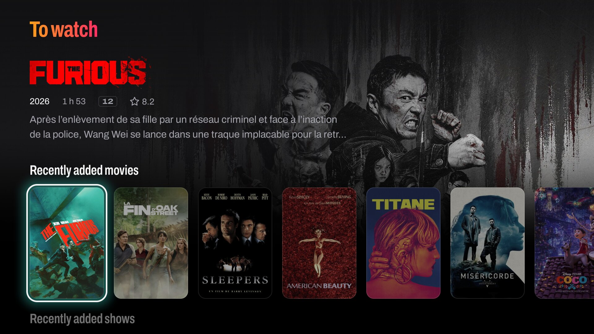
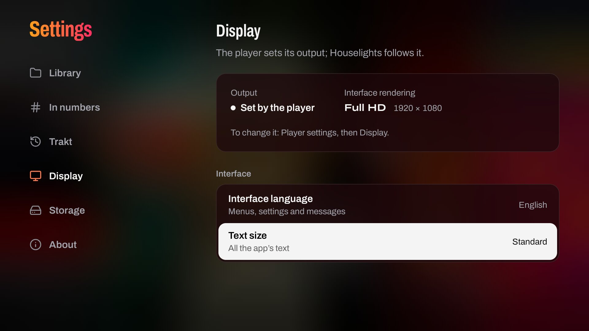

<p align="center">
  
</p>

<h3 align="center">Your films and shows, on the big screen.</h3>

<p align="center">
  A cinema-style media browser for <b>Zidoo</b> players that hands playback to the <b>native Zidoo player</b>,<br>
  so HDR10, HDR10+, Dolby Vision, audio passthrough and the player's own menus keep working.
</p>

<p align="center">
  <a href="https://github.com/lchamp-lab/houselights/releases/latest"></a>
  
  <a href="LICENSE"></a>
</p>

<p align="center">
  <a href="#install"><b>Install</b></a> ·
  <a href="#features">Features</a> ·
  <a href="#screenshots">Screenshots</a> ·
  <a href="https://ko-fi.com/lchamp_lab">Support</a>
</p>


> **Beta.** Made for Zidoo players (Android 9 with Zidoo's launcher), tested on a Z1000 Pro: reports from other
> models are welcome in the [issues](https://github.com/lchamp-lab/houselights/issues). Not affiliated with Zidoo,
> Jellyfin, Emby or Plex.

**En français.** Houselights est une médiathèque façon salle de cinéma pour les lecteurs **Zidoo** (testée sur le
Z1000 Pro) : vos films et séries d’un **NAS** (NFS ou SMB, avec les NFO Kodi et TMDB) ou d’un serveur **Jellyfin**,
lus par le **lecteur natif Zidoo** (HDR10, HDR10+, Dolby Vision, passthrough audio), avec le suivi **Trakt**. Libre et
gratuite, l’application est entièrement en français. [Installer](#install)

## Features

- **The Zidoo player plays.** Files open directly in it (`smb://`, `nfs://` or HTTP), with everything it
  supports. Progress is read from the player while it plays, so resume points stay in sync.
  - Audio and subtitles are asked of it as Settings > Playback sets them for every title (the player's own choice
    by default, or an audio language and subtitles off, forced only, automatic or always, in a language), or as a
    film or a show keeps its own (Audio and subtitles on a film's page or in an episode's options); a change made
    while it plays is kept. Subtitles a film lacks may be in a file beside it (Bazarr's `Film.fr.forced.srt`): the
    player is switched to them once it lists them. Tracks are asked for files whose tracks are known (an MKV the
    scan read, or a Jellyfin title), never for a disc.
- **A 10-foot interface built for the living room**: full-screen backdrops, clear logos, poster rows and
  walls, detail pages with cast, seasons and episodes, in 4K60 where the device allows it. Built with Jetpack
  Compose for TV on its own design system ([DESIGN.md](DESIGN.md)).
  - Home is a grid of doors: the title you were watching to resume in one OK (or a film or show not seen yet), the next
    episode and what is new, a door per library with its number of titles cut in its posters, the sagas, search
    and the app's state. Back on home asks once more before leaving the app.
  - Each door opens its page: a library's wall of posters, without a bar, with its filters and sort; the sagas,
    search or the settings. The doors of what is new and of the next episode open To watch: the rows to
    resume, next up, the latest titles, a director's films and the best rated, under the title in focus. Back
    returns home, on the door you came from.
- **My files**: scans NFS or SMB shares, identifies films and shows from their names, and fetches artwork and
  details from TMDB.
  - Kodi-style NFO files and local artwork (`poster.jpg`, `fanart.jpg`, `clearlogo.png`…) take precedence;
    NFO ids and ids in names identify titles exactly ([Naming your files](#naming-your-files)).
  - Without an id, TMDB's results are weighed (titles, original and alternative ones included, year, votes and
    TMDB's order), never taken first come: a title no result is clearly ahead for is left unidentified with its
    three best candidates rather than matched wrongly, and one TMDB does not know is searched again, daily in its
    first week, then weekly.
  - Technical details are read from the files and set on a title's page as on a case back: a line for the video
    (resolution, Dolby Vision and HDR, codec, frame rate), one for the audio (format, channels, bitrate, and its
    language when a track is asked for), and every track in its technical sheet.
  - Over NFS, symbolic links are followed within the export, as the player follows them; an absolute link, which
    the player cannot follow, is left out and logged.
  - NFS sends no password: the app presents itself to the NAS as root, unless a folder names the user and group
    (UID and GID) to read it as. The Zidoo player opens videos with its own NFS access ([Security](#security)).
  - A folder is tested before it is saved, in the NAS's own words (mount path, shared folder, subfolder): the test
    says what it found, "412 folders and 3 videos", the fields then showing the path as it was read (a whole path
    typed under its mount path keeps only the subfolder), and a failure says what to change under the field to change,
    which takes focus: the shared folder or the export missing, or a subfolder missing in one that answers; the NAS
    refusing this player, by its address, or root, or an SMB account without the right. A folder holding neither a
    video nor a subfolder, or one nesting with a folder of the library, is never saved.
  - Each title can be corrected from its page: poster, backdrop and logo chosen among TMDB's images, or a
    manual match by title, year or IMDb id. Corrections survive later scans.
  - A file deleted from the NAS leaves the library on the next scan; what you did to its title (watched, where you
    stopped, favourite, choices) is kept by title and given back if it returns. When more than a quarter of a
    folder's titles, ten at least, vanish at once while the folder still answers (a disk of the NAS offline, a volume
    not mounted yet), nothing leaves: home says "12 titles of “Films” not found on the NAS" with See, and you answer
    once, Keep (they wait for their files) or Remove (nothing is deleted on the NAS). Meanwhile they stay on the walls
    with a ring on their posters, their page says how long they have been missing and removes one alone (an episode
    from its options), and Play explains rather than trying; Settings > Library counts them on their folder, Remove
    still there. Files coming back end it without a word.
  - Films of a saga are gathered on the Movies wall under one poster (Filter > Show > Sagas lists the sagas
    alone; Settings > Library > Sagas gathers a saga from two of its films, from one, or never), with a page per
    saga showing the films you own and those you don't.
  - A film, a season or an episode is marked watched or unwatched from its page; Menu or Pop Menu (or a long
    press) opens the options of an episode (mark it, play it from the start, its audio and subtitles) and of a
    show's mark (the season or the whole show).
  - Your [Trakt](https://trakt.tv) account connects in Settings > Trakt, with a code entered on your phone
    or computer, and keeps what you watch in your folders (Jellyfin has its own Trakt plugin):
    - a title watched on either side is watched on both, at the date it was seen; in every folder, a title
      is watched from 80 % of its length, as on Trakt;
    - where you stopped goes by the latest of Trakt's pause, the last play here (of the copy that plays)
      and the last play Trakt knows, so a pause older than a play never comes back;
    - marking a title unwatched removes every play of it from Trakt's history, those of other devices
      too; a title only in progress loses its pause alone;
    - marks and stops wait while Trakt cannot be reached, or until the account is connected again once
      Trakt ended its connection; disconnecting forgets them. Under a server as the source, Trakt pauses,
      still connected, and sends what waited once your folders are the source again; Settings > Trakt says
      so meanwhile, and disconnects it.
- **Jellyfin**: browses your server and reports playback progress back to it. Servers found on the network are
  looked for as its choice takes focus on the welcome screen, the first one found focused, and checked as they
  appear, a closed lock on those that answer over HTTPS, as the same server, with a certificate the player trusts
  ([Security](#security)). Switching to your folders keeps the server signed in: it comes back from Settings in one
  OK, without signing in again. Emby and Plex are planned.
- **Without a library** (the last folder removed, or the only server signed out of), the app goes back to its
  welcome screen, wherever it was, to choose where your films are.
- **In your language**: the interface in English, French, German, Spanish, Italian, Portuguese, Dutch,
  Polish, Chinese (simplified and traditional), Japanese and Korean, and details in the language of your
  choice. Both follow the device unless chosen in the settings.
- **At your distance**: text on one scale of eight sizes, its core read at 16 sp, set one step smaller or larger
  than Android's in Settings > Display > Text size (Compact, Standard, Large), for a screen read from close by or
  from the far end of the room; the grid and the pictures keep their size.
- **When something goes wrong**, it is said where it happened: a play that does not start says why on home's
  case, beside a page's actions or under the episode row ("Can't play" over the reason, such as "NAS unreachable"
  or the Zidoo player's own words), until the next OK there. Settings > About > Send the log then opens the app's
  own log on your phone by a QR code ([Support](#support)).

## Naming your files

My files reads a title from its folder's and file's names, as Plex, Jellyfin, Kodi, Radarr and Sonarr name them:

- **Films**: `Dune (2021)/Dune (2021).mkv`, the year in parentheses: a year alone can be read as part of the title
  (`Wonder Woman 1984`). An edition as `Blade Runner (1982) {edition-Final Cut}.mkv`, a film in several files as
  `Heat (1995) CD1.avi` and `CD2` (or `DVD`, `disc`), a disc by its folder (`BDMV`, `VIDEO_TS`).
- **Shows**: `Severance (2022)/Season 01/Severance - S01E02.mkv`; `Specials` or `Season 00` for season 0, `S01E01-E02`
  for a file holding two episodes, `1x02` too.
- **Ids**: a TMDB, IMDb or TheTVDB id in a name identifies the title without a search: `{tmdb-438631}`,
  `[tmdbid-438631]`, `{imdb-tt1160419}`, `[imdbid-tt1160419]`, `{tvdb-371980}`, `[tvdbid-371980]`. A film's ids are
  its file's, else its folder's when the folder holds that film alone, its copies and parts included (never a remake
  beside its original); a show's are its folder's.
- **What counts first**: your choice (Identify, from the title's page), then the ids in names (TMDB, TheTVDB for a
  show, IMDb), then the NFO's, then a search by title and year. A name's id is not trusted when its title's year is
  more than one apart from the name's (a year alone may be the title's: `Death Race 2000 {tmdb-13282}`), or when
  none of its titles, alternative titles included, is the name's, unless the NFO or another id names that title too:
  the title is then found as if the name gave no id. A title whose name gives another id than its last lookup tried
  is looked up again by it, once.
- **Radarr and Sonarr**, as the [TRaSH Guides](https://trash-guides.info) name them: a film's folder
  `{Movie CleanTitle} ({Release Year}) {tmdb-{TmdbId}}`, a show's `{Series TitleYear} {tvdb-{TvdbId}}`.

## Screenshots

<table>
  <tr>
    <td width="50%"><br><sub>A film's page: its video and audio on the case back, read from the file itself.</sub></td>
    <td width="50%"><br><sub>A show's episodes and cast.</sub></td>
  </tr>
  <tr>
    <td width="50%"><br><sub>A saga: the films you own among its films, resumed where you left off.</sub></td>
    <td width="50%"><br><sub>The Movies wall, a saga among the films, lit by the focused poster.</sub></td>
  </tr>
  <tr>
    <td width="50%"><br><sub>To watch, one door from home: its rows under the title in focus.</sub></td>
    <td width="50%"><br><sub>Settings > Display: the interface's language and the text size.</sub></td>
  </tr>
</table>

## Install

Each [release](https://github.com/lchamp-lab/houselights/releases) provides one APK, its SHA-256 and its
changes. A new release installs over the previous one and keeps your library, history and settings.

| Method | How |
|---|---|
| Zidoo | Copy `Houselights-x.y.z.apk` to a USB stick and open it from the player's file manager. |
| In the app | Once installed, Houselights finds its next versions itself (Settings > About > Updates). |
| Automatic updates | Add `https://github.com/lchamp-lab/houselights` to [Obtainium](https://github.com/ImranR98/Obtainium). |
| Computer | `adb install -r Houselights-x.y.z.apk` |

Android may first ask you to allow installs from the app you use.

**Updating from the app.** Once a day, while it is on screen and nothing plays, Houselights asks GitHub whether a newer
version exists. It offers one once, on home, with what is new: Update downloads it, checks it and hands it to Android,
which asks you to confirm; Later waits for the next version, and Settings > About > Updates says where it stands
meanwhile. Your library, history and settings are kept. Android asks once to let Houselights install apps; on a player
whose settings do not open that screen, allow it from a computer:

```
adb shell appops set app.houselights REQUEST_INSTALL_PACKAGES allow
```

Betas are offered only if you choose them (Versions offered: Stable and beta), or if a beta is installed. A build made
without the updater (`-Phouselights.updater=false`, as F-Droid would build it), a debug build, and any build not signed
with the project's key have no updater and never update themselves.

**Verify the signature.** Every release is signed with the project key; Android refuses an update signed
with another one. Check an APK with `apksigner verify --print-certs` or the AppVerifier app. The
certificate's SHA-256 is:

```
CA:0A:DF:07:52:64:58:F6:CB:3E:57:E4:C5:84:66:C4:55:B6:86:F5:84:3A:E6:4D:45:A3:76:A2:93:EB:4D:A8
```

**TMDB key.** A release may ship without a TMDB key. The app then asks for yours (free, from
[themoviedb.org](https://www.themoviedb.org/settings/api)) in Settings > Library > TMDB API key.

## Privacy

Houselights sends nothing about you or your library anywhere. The update check is its one request of its own: once a
day it asks GitHub (Microsoft) for the project's latest releases, sending only what any request does, the player's IP
address, and `Houselights/x.y.z` as its name; no account, no identifier. Turn it off in Settings > About > Automatic
check: Check now still asks when you do. TMDB, Trakt and your servers are reached only as the features you use need
them. To add a folder, the app asks which NAS announce SMB on the local network (mDNS, multicast that never leaves it,
five seconds at most), then tries ports 445 and 2049 of those that answered or that the library uses; it scans no
address.

## Security

- **Prefer NFS**, which needs no credentials. With SMB, the Zidoo player receives the credentials in the file
  URI and Android logs started intents (readable over adb): use a **dedicated read-only NAS account**.
  Credentials only go to the Zidoo's player: a system app or one signed like the firmware's apps; failing
  those, the app under a Zidoo name that first received them, remembered by its certificate. Any other app,
  or that one signed by someone else, receives none. On a firmware signed with Android's public test keys
  (the Z1000 Pro's), anyone can sign an update of the system player that Android installs over it, and it
  would receive them too: install the player's updates from Zidoo alone.
- NFS sends no password: the NAS trusts the player's address and the user it claims, root (uid 0, gid 0)
  unless the folder's "NFS account" names another user and group. Any app on the player can claim root
  too: on an export that does not squash root (Synology's "No mapping"), the export is open with root's rights.
  Export it **read-only, with root squashed** or mapped to a guest or media account; the user the app presents
  only chooses whose rights it reads with, and the Zidoo player opens videos with its own NFS access.
- Finding NAS to add a folder asks one mDNS question to the local network and reads only the answers to it: no
  WS-Discovery, no NetBIOS, no scan of addresses. Ports are tried only on the NAS that answered, sixteen at most, at
  the address they answered from or a private one a relay names, never beyond the local networks, and on those the
  library uses. Over Wi-Fi it holds a multicast lock (`CHANGE_WIFI_MULTICAST_STATE`, granted without asking) for
  those seconds alone. Listing a NAS's shares signs in with the account typed, or as a
  guest, on a connection of its own closed once listed; listing its NFS exports needs no account.
- Passwords, the Jellyfin token, a personal TMDB key, path mappings and Trakt's tokens are encrypted with a key
  held in the Android Keystore, never replaced once made: one the Keystore does not open for now is kept, said as
  such, never tried empty on the NAS, and read again with Retry or on coming back to the app. Android backup is
  disabled. Disconnecting Trakt revokes the app's token there.
- Jellyfin is reached over HTTPS when the server offers it. A certificate the player refuses stops the sign-in
  rather than fall back to plain HTTP, which typing `http://` chooses; refused later (expired, or the player's clock
  wrong), as TMDB's may be, screens say "Certificate refused". Each server found on the network is checked as it
  appears, anonymously, 3 s at most an address: its HTTPS address (the one it announces, else port 8920), then the
  HTTP one it announces. It is "Encrypted" only when HTTPS answers as that same server (its Jellyfin id) with a
  certificate the player trusts; another service on 8920 does not pass. Picked, it is reached as its check says:
  over HTTPS alone once "Encrypted", a failure said rather than a fall back to HTTP; at the HTTP address it announces
  once "Not encrypted", as the list and the panel say before you sign in; once "Not responding", checked again before
  anything is sent, and tried at the address it announces only if still silent. The settings show when a connection
  is not encrypted. Requests carrying the token or the password follow no redirect to another host, or from HTTPS to
  HTTP. A stream played without path mappings carries the token in its URL and is only handed to another app through
  Android's app chooser.
- Changing source signs out of nothing. A Jellyfin server left for your folders keeps its token, encrypted
  like the source's under its own key, so that it comes back without signing in; one server at most, signed out
  of instead when the Keystore cannot encrypt it, and kept as stored when the Keystore has not opened it yet. Its
  token is revoked on the server when you forget it or sign out of it, or when a new sign-in replaces it, and is
  never used again after; a token the server refuses is forgotten.
- Send the log (Settings > About) serves the app's own log on your home network only while its panel is open and the
  app on screen, ten minutes at most: read-only, on the player's private IPv4 address on its home network, never a
  VPN's, at an address holding a random 100-bit code that only the panel shows, each line masked of passwords and
  tokens. The page loads nothing from elsewhere.
- Updates come from the project's releases on GitHub alone, over HTTPS, trusting the system's certificate
  authorities only, every redirect kept to GitHub's hosts (github.com, api.github.com, *.githubusercontent.com) and
  each answer capped. The APK downloaded must have the size and SHA-256 its release's `update.json` gives (and GitHub's
  own digest of it), then Android reads it: it is handed over only for the app's package, a versionCode above the one
  installed, the version name of its tag (a beta's only on a pre-release), and a signer that is the project's key,
  pinned in the app at build time. Android always asks you to confirm, and itself refuses another key or a downgrade.
  An update interrupted leaves the library as it was: what the database was writing is rolled back.
- TMDB and Trakt are reached over HTTPS only, trusting the system's certificate authorities alone. Artwork
  named by NFO files is fetched over HTTPS only, redirects included. Other servers may use plain HTTP: home
  servers are reached by their address, which no rule can name.
- `nfs-client` depends on Netty 3.10 (end of life). Its known vulnerabilities affect HTTP and compression
  codecs that NFS does not use; it will be replaced when a maintained NFS client is available.

To report a vulnerability, see [SECURITY.md](SECURITY.md).

## Support

If Houselights earns its place under your TV, you can support the project on
[Ko-fi](https://ko-fi.com/lchamp_lab). The same page is available as a QR code in Settings > About.

**Reporting a problem.** Right after it happens, open Settings > About > Send the log and scan its QR code with your
phone: it opens Houselights' own log, a crash's lines included, with a line to paste at the top (version, player and
firmware, source, Trakt), to copy or download and attach to your
[issue](https://github.com/lchamp-lab/houselights/issues/new/choose). Passwords and tokens are masked; the names of
your files, shares and NAS stay, so read it before posting. With adb, the lines of the running app only:
`adb logcat -d --pid=$(adb shell pidof -s app.houselights)`.

## Development

Requires JDK 17 and the Android SDK (platform 35).

```sh
echo "tmdb.apiKey=YOUR_KEY" >> local.properties           # optional; never commit it
echo "trakt.clientId=YOUR_CLIENT_ID" >> local.properties  # optional: Trakt, below
./gradlew assembleDebug
scripts/preview.sh                                        # Android TV emulator
scripts/check.sh                                          # the checks CI runs
```

See [CONTRIBUTING.md](CONTRIBUTING.md) for checks, signing, releases and performance tooling, and
[DESIGN.md](DESIGN.md) for the design system.

### Trakt

Settings > Trakt needs the client ID of a Trakt app, built into the APK. Without one, the build says it has
no Trakt key and everything else works.

1. Create the app on Trakt's developer portal ([new API app](https://app.trakt.tv/settings/apps/api/new));
   Trakt first asks you to link a GitHub account, to prove who you are.
2. Choose the Production type, and declare `https://github.com/lchamp-lab/houselights` as its redirect URI
   (`TraktClient.REDIRECT_URI`): connecting with a code never opens it, but renewing the tokens names it. An
   app declared with another URI gives it as `trakt.redirectUri` (`TRAKT_REDIRECT_URI`).
3. Put its client ID in `local.properties` as `trakt.clientId`, or in the `TRAKT_CLIENT_ID` environment
   variable. A client secret is needed only by an app that has one, as `trakt.clientSecret`
   (`TRAKT_CLIENT_SECRET`); built into the APK, it can be read there.

## License

Houselights is free software, released under the GNU General Public License, version 3 or (at your option)
any later version ([LICENSE](LICENSE), `GPL-3.0-or-later`).

- The Archivo typeface is licensed under the SIL Open Font License 1.1
  ([third_party/archivo/OFL.txt](third_party/archivo/OFL.txt)).
- Icons are Lucide's (https://lucide.dev), under the ISC license, those derived from Feather under the MIT
  license ([third_party/lucide/LICENSE](third_party/lucide/LICENSE)).
- This product uses the TMDB API but is not endorsed or certified by TMDB. The TMDB logo is a trademark of
  TMDB, shown under its attribution guidelines, and is not covered by the GPL.
