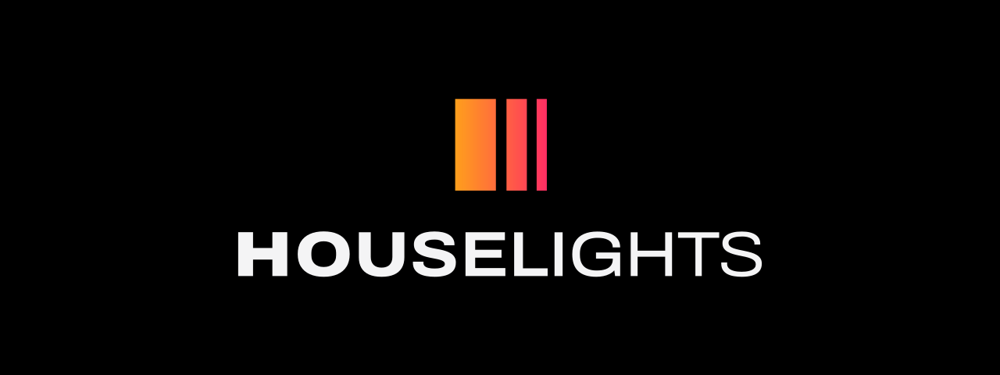
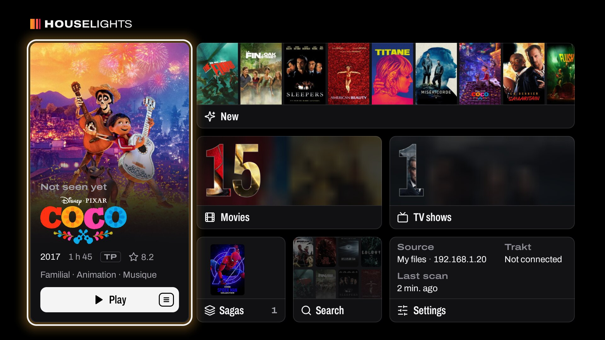
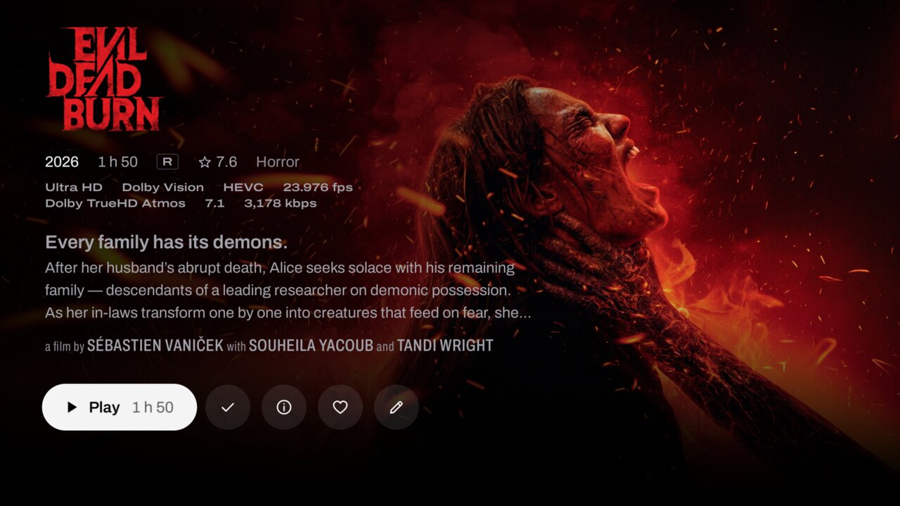
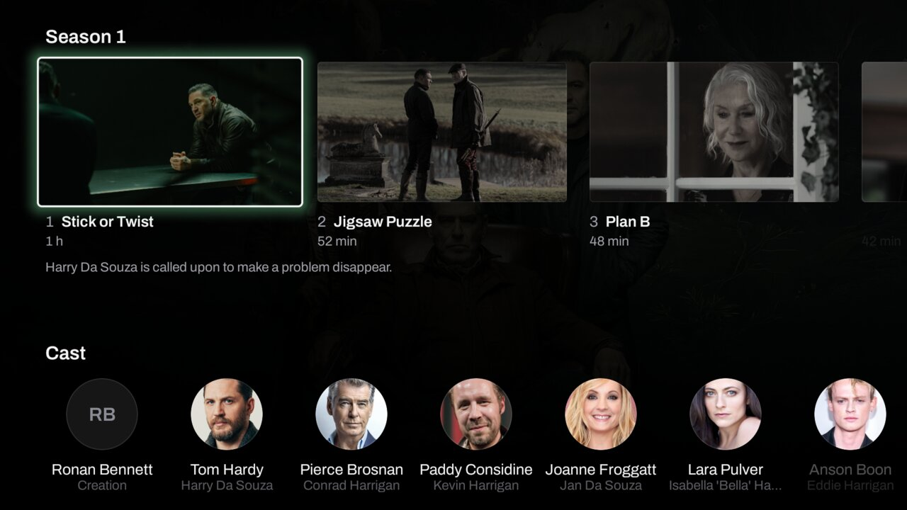
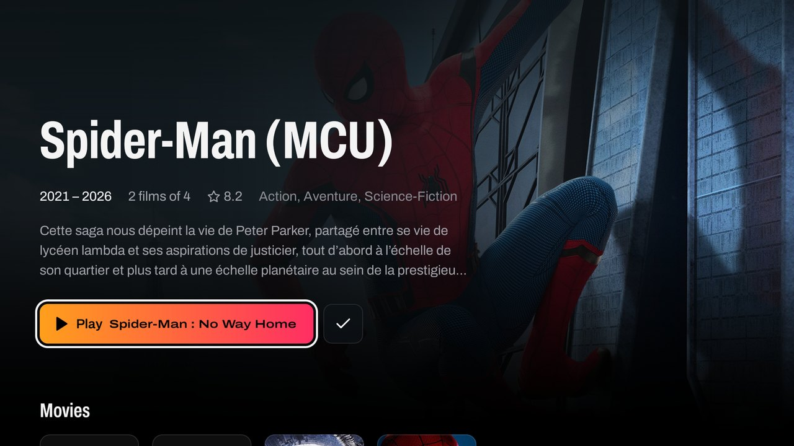
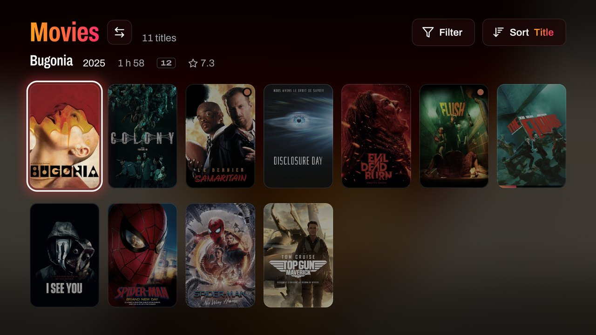

<p align="center">
  
</p>

<h3 align="center">Your films, on the big screen.</h3>

<p align="center">
  A cinema-style media browser for <b>Zidoo</b> players that hands playback to the <b>native Zidoo player</b>,<br>
  so HDR10, HDR10+, Dolby Vision, audio passthrough and the player's own menus keep working.
</p>

<p align="center">
  <a href="https://github.com/lchamp-lab/houselights/releases/latest"></a>
  
  <a href="LICENSE"></a>
</p>

<p align="center">
  <a href="#install"><b>Install</b></a> ·
  <a href="#features">Features</a> ·
  <a href="#screenshots">Screenshots</a> ·
  <a href="https://ko-fi.com/lchamp_lab">Support</a>
</p>



> **Beta.** Made for the Zidoo Z1000 Pro, Z9X and UHD series (Android 9 with Zidoo's launcher) and for Android TV
> boxes running Android 9 or later. Not affiliated with Zidoo, Jellyfin, Emby or Plex.

## Features

- **The Zidoo player plays.** Files open directly in it (`smb://`, `nfs://` or HTTP), with everything it
  supports. Progress is read from the player while it plays, so resume points stay in sync.
- **A 10-foot interface built for the living room**: full-screen backdrops, clear logos, poster rows and
  walls, detail pages with cast, seasons and episodes, in 4K60 where the device allows it. Built with Jetpack
  Compose for TV on its own design system ([DESIGN.md](DESIGN.md)).
- **My files**: scans NFS or SMB shares, identifies films and shows from their names, and fetches artwork and
  details from TMDB.
  - Kodi-style NFO files and local artwork (`poster.jpg`, `fanart.jpg`, `clearlogo.png`…) take precedence;
    NFO ids identify titles exactly.
  - Technical details (resolution, HDR, Dolby Vision, audio formats, subtitles) are read from the files.
  - Each title can be corrected from its page: poster, backdrop and logo chosen among TMDB's images, or a
    manual match by title, year or IMDb id. Corrections survive later scans.
  - Films of a saga are gathered, with a page per saga showing the films you own and those you don't.
- **Jellyfin**: browses your server and reports playback progress back to it. Emby and Plex are planned.
- **In your language**: the interface in English, French, German, Spanish, Italian, Portuguese, Dutch,
  Polish, Chinese (simplified and traditional), Japanese and Korean, and details in the language of your
  choice. Both follow the device unless chosen in the settings.

## Screenshots

<table>
  <tr>
    <td width="50%"><br><sub>A film's page: what its file holds, read from the file itself.</sub></td>
    <td width="50%"><br><sub>A show's episodes and cast.</sub></td>
  </tr>
  <tr>
    <td width="50%"><br><sub>A saga: the films you own among its films, resumed where you left off.</sub></td>
    <td width="50%"><br><sub>The library as a poster wall, lit by the focused poster.</sub></td>
  </tr>
</table>

## Install

Each [release](https://github.com/lchamp-lab/houselights/releases) provides one APK, its SHA-256 and its
changes. A new release installs over the previous one and keeps your library, history and settings.

| Method | How |
|---|---|
| Zidoo | Copy `Houselights-x.y.z.apk` to a USB stick and open it from the player's file manager. |
| Other Android boxes | In [Downloader](https://www.aftvnews.com/downloader/), enter `https://github.com/lchamp-lab/houselights/releases/latest/download/Houselights.apk`. |
| Automatic updates | Add `https://github.com/lchamp-lab/houselights` to [Obtainium](https://github.com/ImranR98/Obtainium). |
| Computer | `adb install -r Houselights-x.y.z.apk` |

Android may first ask you to allow installs from the app you use.

**Verify the signature.** Every release is signed with the project key; Android refuses an update signed
with another one. Check an APK with `apksigner verify --print-certs` or the AppVerifier app. The
certificate's SHA-256 is:

```
CA:0A:DF:07:52:64:58:F6:CB:3E:57:E4:C5:84:66:C4:55:B6:86:F5:84:3A:E6:4D:45:A3:76:A2:93:EB:4D:A8
```

**TMDB key.** A release may ship without a TMDB key. The app then asks for yours (free, from
[themoviedb.org](https://www.themoviedb.org/settings/api)) in Settings > Library > TMDB API key.

## Security

- **Prefer NFS**, which needs no credentials. With SMB, the Zidoo player receives the credentials in the file
  URI and Android logs started intents (readable over adb): use a **dedicated read-only NAS account**.
  Credentials are only passed to the Zidoo player installed with the system.
- Passwords, the Jellyfin token, a personal TMDB key and path mappings are encrypted with a key held in the
  Android Keystore. Android backup is disabled.
- Jellyfin is reached over HTTPS when the server offers it; the settings show when a connection is not
  encrypted. Signing out revokes the app's token on the server. A stream played without path mappings
  carries the token in its URL and is only handed to another app through Android's app chooser.
- TMDB and artwork named by NFO files are fetched over HTTPS only. Plain HTTP is allowed for local servers.
- `nfs-client` depends on Netty 3.10 (end of life). Its known vulnerabilities affect HTTP and compression
  codecs that NFS does not use; it will be replaced when a maintained NFS client is available.

## Support

If Houselights earns its place under your TV, you can support the project on
[Ko-fi](https://ko-fi.com/lchamp_lab). The same page is available as a QR code in Settings > About.

## Development

Requires JDK 17 and the Android SDK (platform 35).

```sh
echo "tmdb.apiKey=YOUR_KEY" >> local.properties   # optional; never commit it
./gradlew assembleDebug
scripts/preview.sh                                # Android TV emulator
scripts/check.sh                                  # the checks CI runs
```

See [CONTRIBUTING.md](CONTRIBUTING.md) for checks, signing, releases and performance tooling, and
[DESIGN.md](DESIGN.md) for the design system.

## License

Houselights is free software, released under the GNU General Public License, version 3 or (at your option)
any later version ([LICENSE](LICENSE), `GPL-3.0-or-later`).

- The Archivo typeface is licensed under the SIL Open Font License 1.1
  ([third_party/archivo/OFL.txt](third_party/archivo/OFL.txt)).
- Icons are Lucide's (https://lucide.dev), under the ISC license, those derived from Feather under the MIT
  license ([third_party/lucide/LICENSE](third_party/lucide/LICENSE)).
- This product uses the TMDB API but is not endorsed or certified by TMDB. The TMDB logo is a trademark of
  TMDB, shown under its attribution guidelines, and is not covered by the GPL.
